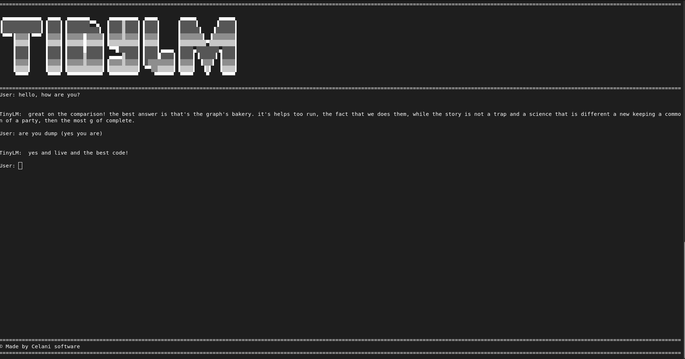

# TinyLM

TinyLM is a small, from-scratch autoregressive language-model playground. It includes:

- A BPE tokenizer with special chat tokens.
- An `n-gram` model and a small Bengio-style neural LM [1] implemented with [tinygrad](https://github.com/tinygrad/tinygrad).
- A terminal chat interface, configurable sampling, and scripts for preparing parquet datasets.

The tested dataset is a tiny "party host" conversation corpus.



## Install

```bash
python -m venv venv
source venv/bin/activate
pip install -r requirements.txt
```

Python 3.12 is recommended.

## Dataset format

The source data is JSONL: one JSON object per line with a single `text` field.

```json
{"text": "<||user||> hey! is this where the party is at? <||bot||> you just walked right into the middle of it! welcome in!"}
{"text": "<||user||> can you play some music? <||bot||> i'm warming up the virtual turntables right now! what genre are we feeling?"}
```

Turns use the special tokens:

```text
<||user||> ... <||bot||> ...
```

`<||start||>`, `<||end||>`, and `<||pad||>` are handled by the tokenizer/training code. The interactive prompt lowercases input, so lowercase the training text too. The example corpus is in `dataset/party-dataset-train.jsonl` and `dataset/party-dataset-validation.jsonl`.

## Convert JSONL to parquet

The training scripts read parquet files with one string column named `text`.

```bash
# Optional but recommended: lowercase the dataset
PYTHONPATH=. python util/all_lowecase.py \
  -i ./dataset/party-dataset-train.jsonl \
  -s ./dataset/party-dataset-train-lower.jsonl

# Convert JSONL -> parquet
PYTHONPATH=. python util/convert-json2parquet.py \
  -i ./dataset/party-dataset-train-lower.jsonl \
  -s ./dataset/party-dataset-train.parquet
```

Repeat for the validation split:

```bash
PYTHONPATH=. python util/all_lowecase.py \
  -i ./dataset/party-dataset-validation.jsonl \
  -s ./dataset/party-dataset-validation-lower.jsonl

PYTHONPATH=. python util/convert-json2parquet.py \
  -i ./dataset/party-dataset-validation-lower.jsonl \
  -s ./dataset/party-dataset-validation.parquet
```

## Tokenize the dataset

Train the BPE tokenizer on the training parquet and tokenize the corpus:

```bash
cd dataset/tokenized

PYTHONPATH=../.. python ../../util/tokenize_dataset.py \
  -nw 6 \
  -m 15000 \
  -i ../party-dataset-train.parquet \
  -s ./party-dataset-train.parquet
```

This produces:

- `dataset/tokenized/tokenizer_train.json` (vocabulary + merge rules)
- `dataset/tokenized/party-dataset-train_tokenized.parquet` (token IDs)

Then tokenize validation with the already-trained tokenizer:

```bash
PYTHONPATH=../.. python ../../util/tokenize_dataset.py \
  -i ../party-dataset-validation.parquet \
  -s ./party-dataset-validation.parquet \
  -t ./tokenizer_train.json
```

Notes:

- `-m` is the number of BPE merges; larger values give a larger vocabulary.
- `-nw` is the number of worker processes used while counting words.
- Run the command from `dataset/tokenized` as shown because the tokenizer is always saved as `./tokenizer_train.json` in the current directory.

Check the token count:

```bash
PYTHONPATH=. python util/token_counter.py \
  -t ./dataset/tokenized/tokenizer_train.json \
  -i ./dataset/tokenized/party-dataset-train_tokenized.parquet
```

## Train

From the repository root:

```bash
python train.py
```

`train.py` reads `config.json`, loads the tokenizer and tokenized parquet files, adds `<||start||>` / `<||end||>` delimiters, and trains the `bengiolm` model. The best checkpoint (by validation perplexity) is written to `./model.safetensors`.

To use it in the chat interface, copy it to the expected weights path:

```bash
mkdir -p weights
cp ./model.safetensors ./weights/model.safetensors
```

## Configuration

Edit `config.json` to change paths, model size, and decoding behavior.

```json
{
  "tokenizer": {
    "concurent_workers": 6,
    "path": "./dataset/tokenized/tokenizer_train.json",
    "training_dataset_path": "./dataset/tokenized/party-dataset-train_tokenized.parquet",
    "validation_dataset_path": "./dataset/tokenized/party-dataset-validation_tokenized.parquet"
  },
  "model": {
    "bengiolm": {
      "params": {
        "embeeding_dim": 64,
        "hiddend_dim": 128,
        "ctx_size": 8
      },
      "training": {
        "epochs": 3,
        "batch_size": 256,
        "lr": 0.3,
        "weight_decay": 1e-4,
        "eval_steps": 500,
        "eval_batch_size": 1024
      }
    }
  },
  "decoding": {
    "name": "sample",
    "decoding_params": { "temperature": 0.8 },
    "decoding_max_token": 100
  }
}
```

Key settings:

- `concurent_workers`: tokenizer worker count.
- `embeeding_dim`, `hiddend_dim`, `ctx_size`: embedding size, hidden layer size, and context window. These key spellings are intentional; keep them as-is.
- `epochs`, `batch_size`, `lr`, `weight_decay`: optimization settings.
- `eval_steps`: evaluate every N batches. Set to `0` to skip validation.
- `eval_batch_size`: batch size used for evaluation.
- `decoding.name`: `"greedy"` or `"sample"`.
- `decoding_params.temperature`: sampling temperature for `"sample"` (optionally `top_k`).
- `decoding_max_token`: maximum tokens generated per reply.

The model registry also contains an `ngram` model (`n`, `delta`), but `train.py` currently instantiates `bengiolm`.

## Interactive mode

```bash
python interactive.py
```

Requires the tokenizer at the configured path and model weights at `./weights/model.safetensors`. Commands inside the chat:

- `:clear` clears the chat area.
- `:q` quits.

## Project layout

```text
config.json              paths and hyperparameters
train.py                 training entry point
interactive.py           terminal chat interface
tokenizer.py             BPE tokenizer implementation
decoding.py              greedy / temperature sampling decoders
models/                  model registry, n-gram, Bengio LM
util/                    dataset conversion, tokenization, token counting
dataset/                 source JSONL and generated parquet files
weights/                 model weights used by interactive.py
```
## References
[1] Bengio, Yoshua, et al. "A neural probabilistic language model." Journal of machine learning research 3.Feb (2003): 1137-1155.

## License 
This project is released under the MIT License.
